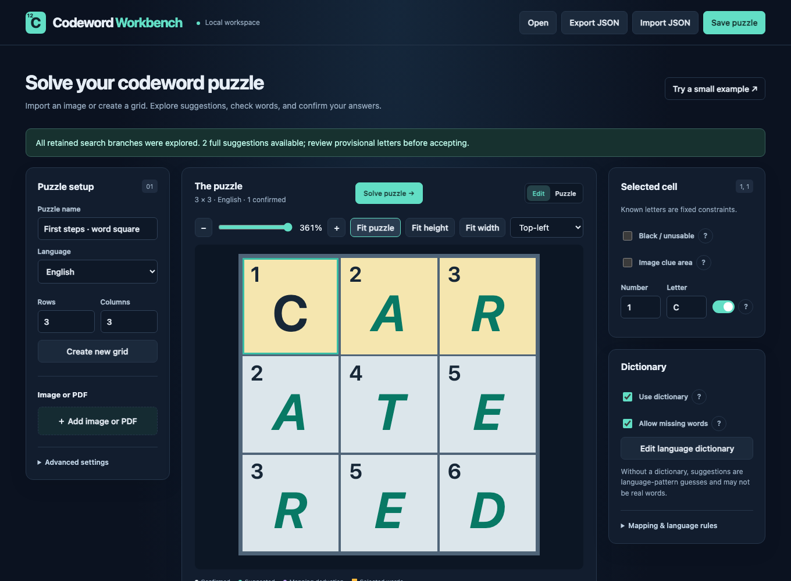

# Codeword Workbench

A local browser workspace for solving codeword puzzles (number-cipher
crosswords) in English, Finnish, Dutch and Swedish. Import a screenshot, photo
or PDF of a puzzle, or draw the grid yourself; the app reads the grid and
numbers, solves it with or without a word list, and lets you accept letters
one cell, word or mapping at a time.



- **Grid recognition:** detects the main grid, cell numbers, black cells and
  picture areas in screenshots, photos and PDFs, with a straighten tool for
  tilted or curled magazine photos.
- **Solver:** indexed, cancellable constraint search with crossing and
  number-mapping propagation; tolerates names and other words missing from
  the dictionary.
- **Without a dictionary:** per-language letter-pattern models score whole
  letter mappings across all crossing words. In testing on several full-size
  printed puzzles, **Deep** search solved the grid with no word list
<<<<<<< HEAD
  installed; **Quick** search was not enough. Letters whose number could
  take another letter at almost no cost are outlined, so you know where to
  check first. The same models flag implausible words.
- **Make your own puzzles:** draw a grid, optionally fix some numbers and
  letters or list words to include, and generate a codeword filled from your
  word list. Choose Easy, Medium or Hard: the app grades the puzzle by solving
  it step by step and gives letters until it fits, with only one answer.
  Solve it in the app with an answer check, or print it with its number key
  and solution.
=======
  installed; **Quick** search was not enough. The grid shows the best guess
  live, shaded by how clearly each letter beats its best rival, so you know
  where to check first. Afterwards, a replay steps through how the grid
  settled. The same models flag implausible words.
>>>>>>> origin/main
- **Honest output:** confirmed letters stay separate from suggestions, and
  every suggested word says what supports it.
- **Local-first:** a Python standard-library server on 127.0.0.1; no
  accounts, external services or CDN assets.

## Quick start

Requires Python 3.10 or newer.

```sh
python3 run.py
```

Open <http://127.0.0.1:8765>, choose **Full-size showcase**, then **Solve
puzzle**: an original 13 × 13 codeword with no letters given is solved
without a dictionary, the grid shows the best guess while the search runs,
and the app then reports how many cells match the known answer. **Try a small
example** loads a 3 × 3 word square instead. Use `--port 8766` if the port is
taken and `--data-dir /path` to keep data elsewhere. On macOS, `start.command` starts
the server with a double-click.

Optional extras:

- **Screenshot and photo recognition:** `python3 -m pip install -r requirements.txt`
  (Pillow) and Tesseract with English data from your package manager
  (`brew install tesseract`, `sudo apt install tesseract-ocr`).
- **PDF import:** Poppler's `pdfinfo` and `pdftoppm`
  (`brew install poppler`, `sudo apt install poppler-utils`).

## Dictionaries

The app ships only small demonstration word lists, and real puzzles may not
need more: turn off **Use dictionary** and run a **Deep** search.
Importing a full list per language is optional. With one, search places
listed words, so each suggested word carries dictionary evidence instead of
resting on letter patterns alone. [docs/dictionaries.md](docs/dictionaries.md)
lists free sources (Kotus, Joukahainen, OpenTaal, SALDO, Webster's) and the
scripts that convert them to the one-word-per-line import format.

## Benchmark

`scripts/benchmark_solver.py` solves five original 13 × 13 grids
(`scripts/benchmark_puzzles.json`, the first is the showcase) under two
number keys each, with no letters given. Each grid has exactly one fill
within Webster's Second International; the generator rejects grids with
more. On a 4-core Linux container:

| Configuration | Grids fully right | Worst grid | Time |
|---|---|---|---|
| No dictionary, Quick | 6 of 10 | 98.3% of cells | 2.1 s (final answer first shown after 0.2 s) |
| No dictionary, Deep | 6 of 10 | 98.3% of cells | 51 s (stops at its node limit) |
| Webster's 2nd (236,000 words), Quick or Deep | 10 of 10 | 100% | about 1 s, including indexing |

Without a dictionary, the 6 wrong cells were all shaded coral (close
rival); 22 cells were coral in total, and none of the 50 light-coral or
1,060 unshaded cells was wrong. Deep search left the same cells wrong as
Quick: there, the letter model prefers the wrong letter, and only a word
list settles it. These generated grids are easier than many printed
puzzles: on real puzzles, Quick search without a dictionary was not enough
in testing, so the app uses Deep when the dictionary is off.

## Documentation

- [How codeword solving works](static/how-it-works.html): the solving
  stages, a step-through of the search, and every limit the solver applies
  (also the first button in the app).
- [User guide](docs/user-guide.md): every feature, search controls and limits.
- [Dictionaries](docs/dictionaries.md): sources, conversion, Finnish
  inflected forms, rebuilding the letter models.
- [Hosted mode](docs/railway.md): opt-in Docker/Railway deployment with a
  guest mode and a password-protected user mode.

## Project layout

- `app/server.py`: localhost API, schema checks, persistence and static assets.
- `app/solver.py`: validation and bounded constraint search.
- `app/dictionaries.py`: demonstration and custom vocabularies.
- `app/generator.py`: fills a drawn grid from the dictionary and numbers it.
- `app/language_model.py`: character models, soft spelling rules and pattern
  checks; `app/models/` holds the bundled counts.
- `app/ocr.py`, `app/number_reader.py`, `app/straighten.py`: image
  validation, Tesseract adapter, digit consensus and photo flattening.
- `static/`: browser interface, pure state helpers and printable sheets
  (`print.js`); no build step.
- `scripts/`: dictionary conversion, model building, the showcase grid
  generator and benchmarks.

User data (puzzles, dictionaries, autosave) lives under `data/`, which is
excluded from source control.

## Tests

```sh
python3 -m unittest discover -s tests -v
node --test tests/*.cjs
```

OCR tests need Pillow; text-recognition tests skip without Tesseract. HTTP
tests use an ephemeral localhost port and a temporary data directory.

## Licence

MIT; see [LICENSE](LICENSE). The bundled letter models are derived from
third-party word lists under CC BY 4.0, Revised BSD / CC BY 3.0 and public
domain terms; credits are in [app/models/README.md](app/models/README.md).
Finnish vowel-harmony guidance follows
[Kielitoimiston ohjepankki](https://kielitoimistonohjepankki.fi/ohje/vierassanojen-taivutuspaatteen-vokaali/).
